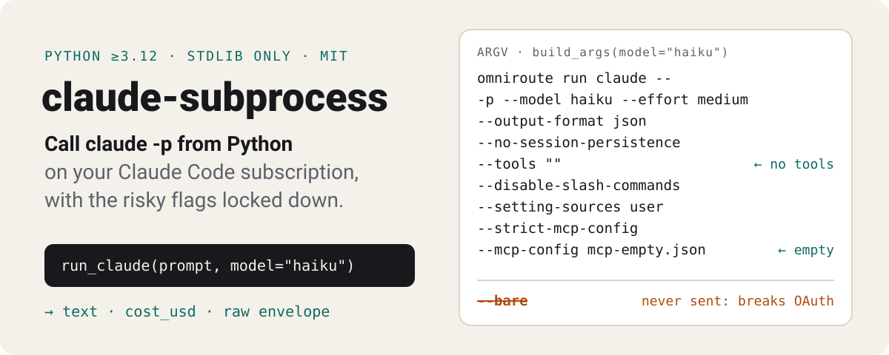
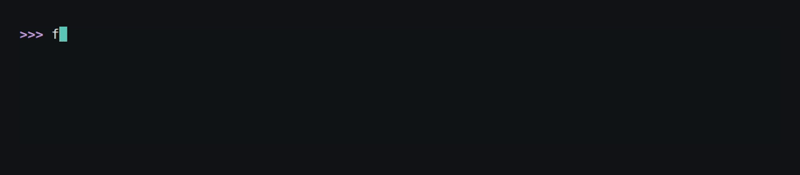
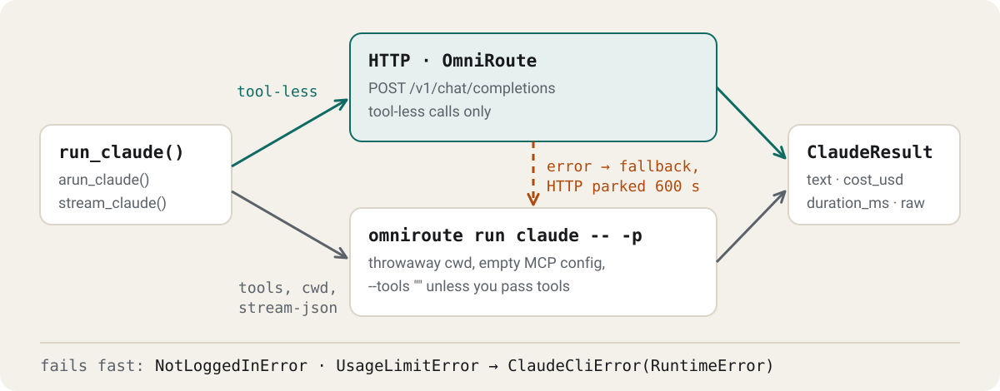

<p align="center">
  <picture>
    <source media="(max-width: 600px) and (prefers-color-scheme: dark)" srcset="https://raw.githubusercontent.com/octrow/claude-cli/main/assets/readme/hero-mobile-dark.svg">
    <source media="(max-width: 600px)" srcset="https://raw.githubusercontent.com/octrow/claude-cli/main/assets/readme/hero-mobile-light.svg">
    <source media="(prefers-color-scheme: dark)" srcset="https://raw.githubusercontent.com/octrow/claude-cli/main/assets/readme/hero-dark.svg">
    
  </picture>
</p>

[](https://github.com/octrow/claude-cli/actions/workflows/ci.yml)
[](https://pypi.org/project/claude-subprocess/)

[](https://github.com/octrow/claude-cli/blob/main/LICENSE)

Run Claude Code headless (`claude -p`) from Python on your subscription, with no API key.

It builds the flags, isolates the call, sorts the errors and parses the answer.
Calls go through the [OmniRoute](https://github.com/octrow/claude-cli/blob/main/docs/OMNIROUTE.md) gateway, which picks the route.
Six of my projects had their own copy of this code, and this library replaced them.

Standard library only, Python 3.12+.



## Install

```bash
uv add claude-subprocess   # or: pip install claude-subprocess
```

The PyPI name is `claude-subprocess`, the import name is `claude_cli`.
At runtime you need `omniroute` and `claude` on `PATH`, with Claude Code logged in.

## Usage

```python
from claude_cli import run_claude, extract_json

res = run_claude('Reply with {"ok": true}', model="haiku", effort="low", timeout=60)
res.text  # the model's answer
res.cost_usd  # cost the envelope reported (may be None)
res.duration_ms
res.raw  # the full envelope dict
extract_json(res.text)  # {'ok': True}
```

`extract_json` tolerates code fences and prose around the object:

```python
>>> extract_json('Sure! Here it is:\n```json\n{"ok": true}\n```\nAnything else?')
{'ok': True}
```

Async, streaming, cache, batch, project mode and pre-flight checks: [docs/usage.md](https://github.com/octrow/claude-cli/blob/main/docs/usage.md).

## How a call is routed

<picture>
  <source media="(max-width: 600px) and (prefers-color-scheme: dark)" srcset="https://raw.githubusercontent.com/octrow/claude-cli/main/assets/readme/flow-mobile-dark.svg">
  <source media="(max-width: 600px)" srcset="https://raw.githubusercontent.com/octrow/claude-cli/main/assets/readme/flow-mobile-light.svg">
  <source media="(prefers-color-scheme: dark)" srcset="https://raw.githubusercontent.com/octrow/claude-cli/main/assets/readme/flow-dark.svg">
  
</picture>

Tool-less calls go over HTTP to the gateway. Calls that need tools, a project `cwd` or `stream-json` go through the CLI.
If HTTP fails, the call falls back to the CLI and HTTP is paused for 600 s.

Rules, switches and env vars: [docs/routing.md](https://github.com/octrow/claude-cli/blob/main/docs/routing.md). Step by step: [docs/logic-map.md](https://github.com/octrow/claude-cli/blob/main/docs/logic-map.md).

## How it differs

- [Claude Agent SDK](https://code.claude.com/docs/en/agent-sdk) (`claude-agent-sdk`) is the official way to drive Claude Code from code, with the full agent loop. Use it to build an agent or a product. Its docs ask third-party products to use API keys, not a claude.ai login.
- This library is for your own scripts on your own subscription: one prompt in, text or JSON out, no dependencies.
- [`anthropic`](https://github.com/anthropics/anthropic-sdk-python) is the Messages API, billed per token on an `ANTHROPIC_API_KEY`. Use it when you have a key and want every API feature.
- `subprocess.run(["claude", "-p", ...])` is what this library replaced. The hard parts are the isolation flags, killing the process tree on timeout, telling a usage limit from a login problem, and parsing the envelope.

## Invariants

These are the reason the library exists.

- `--bare` is never passed. It forces API-key-only mode and breaks subscription auth. A test checks it.
- Every Claude Code subprocess is launched via `omniroute run claude`, and the HTTP route talks to the same gateway.
- The surface is isolated: an empty temp MCP config with `--strict-mcp-config`, `--setting-sources user`, `--disable-slash-commands`, `--no-session-persistence`.
- Every call gets a throwaway cwd, so no project `CLAUDE.md` gets loaded.
- `--tools ""` is the default. A non-empty `tools` value goes to both `--tools` and `--allowed-tools`, because headless `-p` denies anything not allow-listed.
- `--output-format json` and `stream-json` both end up as the same `ClaudeResult`.

## Errors

All errors derive from `ClaudeCliError(RuntimeError)`.
`NotLoggedInError` and `UsageLimitError` fail fast, so a batch stops at the first one.
Causes and gateway diagnosis: [docs/routing.md](https://github.com/octrow/claude-cli/blob/main/docs/routing.md#errors).

## Tests

```bash
uv run --extra dev pytest -q
```

The suite fakes the subprocess calls and never runs the real `claude` binary.

## License

[MIT](https://github.com/octrow/claude-cli/blob/main/LICENSE). Contributions: [CONTRIBUTING.md](https://github.com/octrow/claude-cli/blob/main/CONTRIBUTING.md).
