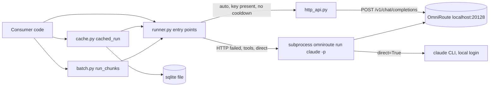

# System design review: claude-cli

Reviewed 2026-11-05. Kind: Python library (no server, no console script). Flow, branches and error classes are in
[logic-map.md](logic-map.md); not repeated here. Steps 3 and the cache-server part of 5 are n/a.

## Assumptions

- Users: 1 (the owner), in-process callers across ~/dev (market-sources, tlf, greenkeep, jobs ...). Consumer count assumed, not counted.
- Load per consumer batch: 500 to 5000 LLM calls/day, assumed (no per-call volume metric exists in the lib).
- Latency per call: HTTP combo `free-stack` ~ 5-30 s, CLI spawn ~ 10-60 s. Assumed; not measured.
- Measured: 2304 LOC in 8 modules (`wc -l src/claude_cli`), 85 commits, 43 of them on 2026-11-01 (`git log`).
- Measured: gateway call logs `~/.omniroute/call_logs` = 77 MB, dated dirs from 2026-10-27 (`du`). Owned by OmniRoute, not this lib.
- Measured: no cache DB found under `~/` named `*cache*.db` with "claude" in the path; cache size is unknown (consumers pick the path).
- Not done: no ssh, no API calls, no app start.

## 0. What exists

Library, stdlib only (urllib/subprocess/sqlite3). Entry points `run_claude`, `arun_claude`, `stream_claude`, `ping`,
`ClaudeCliProvider.ask`, `cached_run`, `run_chunks` (see logic-map "Entry points"). Two backends: HTTP to local
OmniRoute (`http_api.py`), else a CLI subprocess (`runner.py:1010 lines`, the largest module). No queue, no daemon,
no DB server; one optional sqlite file (`cache.py`). Deploy = pip install (editable) into consumers.

Rung today: **rung 1, single process, no infrastructure** (`references/scale-ladder.md`). Correct for the load.

## 1. Requirements

One sentence: give Python callers one blocking/async call that turns a prompt into text through the cheapest
available route, and fails with typed errors.

- Functional: ask (HTTP then CLI fallback), stream events, cache answers on disk, batch many prompts with a failure budget, preflight/health.
- Out of scope: auth management, retries with backoff, model routing logic (lives in OmniRoute), multi-host use.
- NFR (assumed): latency = upstream latency + <50 ms overhead; availability = survives gateway down via CLI fallback; durability = cache loss is harmless; security = bearer key never sent over non-loopback http or via redirect; observability = INFO/WARNING log lines per call.

## 2. Napkin math

Two runs. Run A: 1 caller, 500 calls/day, peak x5. Run B: a batch day, 5000 calls, one caller, flat.
Per-call upstream cost dominates, so "server-rps" is set to what ONE worker carries (1 call / 5 s = 0.2; 1 / 2.5 s = 0.4, assumed).

```
Run A: --dau 1 --req-per-user 500 --peak 5 --server-rps 0.2 --hit-rate 0.3 --read-share 0.7 --object-kb 2 --retention-years 5
  requests/day 500, peak 0.0 req/s, servers (workers) 2, cache memory 140 kB,
  storage per year 328.5 MB (x3 repl, ignore: one file), after 5y 1.6 GB (x3), verdict: rungs 1-2, ship it.
Run B: --dau 1 --req-per-user 5000 --peak 1 --server-rps 0.4 --hit-rate 0.5 --object-kb 3 --retention-years 1
  requests/day 5.0k, avg 0.1 req/s, servers (workers) 2, cache memory 1.5 MB.
```

Read: the "servers" line means concurrent workers. 2 workers cover both runs. Cache rows are ~2-3 kB (response text; prompt column NULL by default),
so one year at 5000 rows/day is roughly 0.5 to 1 GB at the script's x3 replication factor; without it ~ 0.2-0.5 GB. Disk is not the limit; the root
partition is tight (memory note: `/` hit 100% on 2026-07-26), so put cache files under `/mnt/ntfs` or a data dir.

## 3. API contract

n/a as a network API. Python surface is in logic-map "Entry points". Idempotency: none needed; `cached_run` key is sha256 of
normalised prompt+model+options, so a repeat is a cache hit, not a duplicate spend.

## 4. Architecture (rung 1)



- `http_api`: no spawn cost, a request is ms of overhead vs ~1 s for a Node CLI start (assumed). Why it exists: cost 0 and speed.
- Subprocess path: only way to carry tools/slash commands/stream events; also the fallback when the gateway is down.
- `cache.py` sqlite file: repeats of the same prompt are free; one file needs no server. Right for 1 user.
- `batch.py`: packs items under a token budget, bounded thread pool; the spend-stop rule is the only backpressure.
- Not added, correctly: queue, Redis, shared cache, circuit-breaker service. The 600 s process-wide cooldown is the breaker.

## 5. Data

Table `claude_cli_cache(key PK, model, purpose, prompt, response, cost_usd, duration_ms, created_at)` (`cache.py:64`). PK index serves
the only query (`get` by key). Pattern: cache-aside, written by `cached_run` on miss; TTL = optional `max_age_days`, applied at read.
Findings at `cache.py:101-135`:
- every `get`/`put` opens a new sqlite connection (cost ~100 us, fine at <1 call/s) and uses WAL with a 30 s busy timeout (since 2026-11-05).
- No eviction: `max_age_days` makes rows read as misses, nothing is deleted. File only grows (see Risks).
- Cache down (file unreadable): read and write errors are logged, a read error counts as a miss (since 2026-11-05).

## 6. Scale and failure

x10 (50k calls/day, ~0.6 req/s avg): the lib is not the bottleneck. First to saturate is the upstream: OmniRoute free-stack
quotas/rate limits and `claude` subscription limits, then local CPU/RAM from concurrent `claude` Node subprocesses (CLI path; each
~150-300 MB RSS, assumed). With `run_chunks(workers=8)` on the CLI path that is ~1.2-2.4 GB at once, assumed.

| Failure | What happens | Verdict |
|---|---|---|
| Gateway down (`auto`) | `HttpLlmError`, cooldown 600 s for all models, CLI fallback; CLI also goes via the gateway (`omniroute run`) | Fallback is not independent unless `direct=True`; both die with the gateway |
| Gateway slow (8 s) | HTTP timeout = `timeout` (300 default); connect/header/read each get their own budget | A hung gateway can burn up to ~3x `timeout` before CLI fallback |
| Gateway 429/5xx burst | one error parks HTTP 10 min for the whole process | Safe but coarse; a single flaky call turns a whole batch to slow CLI path |
| Not logged in / usage limit | typed error; `run_chunks` stops spending when session-wide | Good |
| CLI hangs | process-group SIGKILL at remaining budget | Good |
| Cache DB locked (parallel workers) | WAL + 30 s busy timeout (since 2026-11-05); past that, `put` error logged, row lost, call still returns | Acceptable; silent loss of savings now rare |
| Host/disk full | cache write logged; temp dir for mcp config fails the CLI path | Root partition tight |

Retries: none in the lib by design (Claude Code retries 2x inside via `CLAUDE_CODE_MAX_RETRIES=2`). No jittered backoff, so a batch hitting
429 spends its whole cooldown on CLI. Rate limiting: none client-side. Backups of cache: not needed (rebuildable).

## 7. Trade-offs

- Fallback to CLI vs fail fast: availability bought with latency and RAM, and with a different cost profile (CLI via subscription).
- Process-wide cooldown vs per-model: simple and cheap, but one bad model parks all models.
- sqlite file vs server cache: zero ops, single writer; breaks down with many concurrent processes sharing one file.
- Library state in module globals (`_down_until`) vs object: no setup, but no per-instance isolation and hard to test.
- No retries/backoff: predictable cost, but callers each re-implement it.

## 8. Summary

Design in three lines: a stdlib-only library at rung 1; HTTP-first to local OmniRoute with CLI-subprocess fallback; optional sqlite
cache-aside plus a thread-pool batcher with a spend-stop rule. It holds the real load (<= 5k calls/day, one user) with 2 workers.
What would change it: calls >50k/day, several processes sharing one cache file, or the CLI path becoming the default (RAM).
Next rung: move the cache to WAL mode, then Postgres/Redis only if >1 writer process; trigger = "database is locked" log lines
in more than 1% of `put` calls, or cache file > 1 GB. A per-model cooldown when more than one combo is used in a batch.

## Risks

- MEDIUM `src/claude_cli/http_api.py:259-263`: one non-per-request HTTP failure parks HTTP for all models for 600 s; a 429 on `hard` also silences `free-stack` and moves a batch to the slower, RAM-heavy CLI path (see logic-map step 5).
- MEDIUM `src/claude_cli/batch.py:98-100` with `runner.py` CLI path: `workers=N` spawns N concurrent `claude` Node processes with no cap or memory guard (~N x 150-300 MB, assumed); on the tight root partition/RAM box this is the first local resource to run out.
- MEDIUM `src/claude_cli/cache.py:101-104`: plain `sqlite3.connect` per call, no WAL, default busy timeout; parallel `run_chunks` workers through `cached_run` can lose writes ("database is locked" is logged, not raised).
- MEDIUM `src/claude_cli/cache.py:107-114`: read errors propagate; a corrupt or unreadable cache file fails the LLM call instead of acting as a miss.
- LOW `src/claude_cli/cache.py:51-60` (`max_age_days`): expired rows are never deleted; cache file grows without bound (est. 0.2-1 GB/year at 5000 calls/day, assumed).
- LOW `src/claude_cli/http_api.py:37-41`: timeout covers each phase, not the whole HTTP call; worst case several times `timeout` before the CLI fallback starts (logic-map step 4).
- LOW `src/claude_cli/runner.py:895`: `arun_claude` HTTP runs in `asyncio.to_thread`; a cancelled task leaves the request running (logic-map "Entry points"); with default thread pool this can pile up under cancel storms.
- LOW `src/claude_cli/http_api.py:41`: `_down_until` is an unlocked module global shared by threads; benign race (worst case one extra probe).
- LOW (observability): no metrics on call count, HTTP-vs-CLI ratio or cooldown trips; only INFO/WARNING lines, so "what breaks first" is invisible until a batch is slow.
